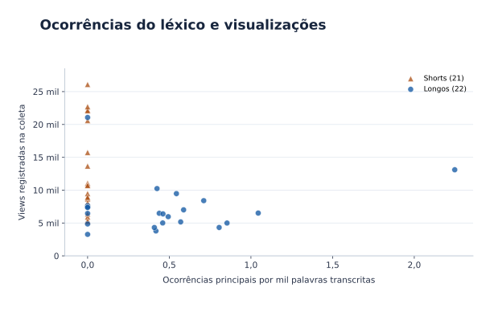
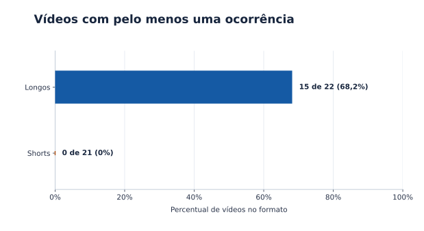

# Figuras | Pesquisa LoL — Corpus Yiok

As duas figuras usam a [tabela publicada dos 43 vídeos](../resultado-mol-yiok-43-videos.csv). O léxico sem frases específicas de cena é a referência; o léxico com frases produziu as mesmas taxas neste corpus. As visualizações são as registradas na base de coleta, e não as contagens atuais do YouTube.

## Figura 1. Ocorrências do léxico e visualizações

**Legenda.** Cada ponto representa um vídeo: a posição horizontal indica as ocorrências principais por mil palavras transcritas, e a altura mostra as visualizações. Alguns pontos próximos se sobrepõem. A correlação de Spearman foi −0,350 no conjunto dos 43 vídeos e +0,067 entre os 22 longos. Todos os Shorts ficaram com taxa zero, então a correlação nesse formato é indefinida. A associação negativa no conjunto não demonstra que as ocorrências diminuem as visualizações.

## Figura 2. Vídeos com pelo menos uma ocorrência, por formato

**Legenda.** Cada barra indica a porcentagem de vídeos daquele formato que tiveram pelo menos uma correspondência de um termo principal do léxico nas falas transcritas. Foram 15 de 22 vídeos longos (68,2%) e 0 de 21 Shorts. Esse zero indica que o léxico não captou os termos selecionados nesses Shorts; não comprova ausência de misoginia. Tampouco uma ocorrência isolada comprova um caso de misoginia.

Fonte: corpus Yiok e [caderno de análise](../../../../../scripts/analise-mol-yiok.ipynb). Ver também as [decisões metodológicas](../../../../../artigo/decisoes-metodologicas.md).
